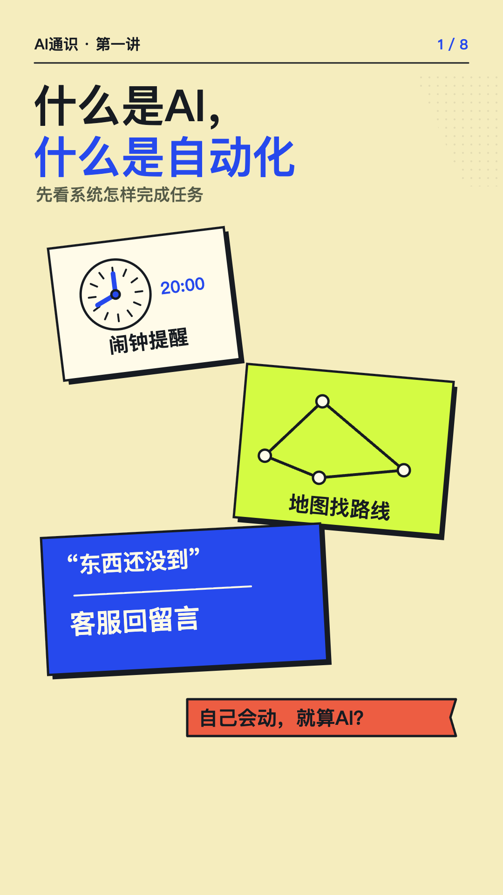

# Tianyu Course Motion · 天雨动效课程工具

**把讲解、字幕和 SVG 动画放到同一条时间线上。** 一个可以随时跳转的竖屏课程播放器，附一讲完整中文技术示例。

**A small, seekable SVG lesson player with synchronized narration and captions.** Open-source player and export tools, with one separately licensed Chinese lesson example.

[在线体验 / Live demo](https://tianyuchuanmei2026.github.io/tianyu-course-motion/) · [完整 AI 通识课](https://tianyuxuezhang.com/academy/courses/ai-literacy?utm_source=github&utm_medium=readme&utm_campaign=course_motion) · [授权范围 / Licensing](LICENSE)

<a href="https://tianyuchuanmei2026.github.io/tianyu-course-motion/"></a>

## 先试一讲

示例《什么是 AI，什么是自动化》约 **3 分 56 秒**，共 **8 场**，含真实配音、字幕和完整动作时间。点击播放，或拖动进度条观察同一场景在不同时间的状态。

- **旁白驱动画面**：用实际音频时间安排字幕与动作，浏览器播放使用同一音频时钟。
- **任意跳转**：按时间恢复图层和关键状态，支持回看、逐帧导出和局部修改。
- **手机竖屏**：1080 × 1920 的 SVG 画布，按浏览器窗口缩放。
- **本地预览无需 API key**：已有示例配音随项目提供；不会调用生成服务。
- **可选 MP4 导出**：用本机 Chromium 和 FFmpeg 渲染，工具不会自动购买或调用付费服务。

本项目来自雨哥 AI 通识课的实际制作过程，使用生成式 AI 辅助开发。这是第一版工程提取，不是输入任意讲稿即可自动产出优质课程的平台。新课程仍需编写场景、准备音频、安排动作并实际审看。

## 本地运行

需要 Node.js **22.12 或更新版本**。预览不需要先安装 npm 依赖。

```bash
git clone https://github.com/Tianyuchuanmei2026/tianyu-course-motion.git
cd tianyu-course-motion
npm run serve
```

打开终端提示的本地地址，默认是 `http://127.0.0.1:4173/`。端口被占用时：

```bash
npm run serve -- --port 4175
```

不要直接双击 HTML 文件；时间轴和音频需要通过本地 HTTP 服务读取。音频在第一次点击播放时载入，首次可能需要稍等。

## 怎样做自己的课程

1. 使用 `src/` 里的播放器与时间轴运行代码。
2. 自己编写场景画面，准备有权使用的讲稿、配音和图片。
3. 按真实配音时长填写字幕与动作时间，接入播放器。
4. 先检查开头、中段、练习与结尾，再导出并审看完整成片。

示例的 `scenes.js`、`timing.json`、`effects.js` 展示了接口怎样连接。**工具代码可以复用，示例课的内容授权较窄，请先看 [示例许可](examples/lesson-01/LICENSE.txt)。** 独立创作并销售自己的课程是允许的；不能把本示例换名字、换声音后当作自己的课程传播或销售。

## 目录

| 路径 | 用途 | 授权 |
|---|---|---|
| `src/` | 通用时间轴、字幕、播放器和样式 | MIT |
| `scripts/`、`tests/` | 本地预览、导出和技术检查 | MIT |
| `docs/` | 使用说明 | MIT，另有说明的内容除外 |
| `examples/lesson-01/` | 第一讲画面、讲稿、定时、配音与封面 | 个人学习和本地验证许可，非开源内容许可 |
| `LICENSES/` | 许可文本 | 按文本说明 |

**完整付费课程未包含在本仓库中。仓库采用分区授权，不能把整个仓库一概视为 MIT。**

## 验证与导出

```bash
npm test
# 浏览器检查与导出需要安装开发依赖，并准备本机 Chrome / Chromium
npm ci
npm run test:browser
npm run export -- --help
```

详细参数与已知限制见 [运行和导出](docs/usage.md)。系统字体在不同电脑上可能有差异；本项目没有打包商业字体。导出速度取决于画面复杂度、分辨率和机器性能，不能按开发用时推算所有课程的出片速度。

## 反馈与贡献

欢迎提交可复现的问题、通用代码修复，以及用这套工具制作的原创案例。描述问题时附浏览器、操作步骤和出现问题的时间点；请勿上传个人资料、密钥或无权传播的课程素材。

提交工具代码默认按 MIT 许可贡献。新增教学内容需明确来源与使用授权。署名、源码和授权记录请保留；品牌、人物形象及第三方素材不因工具开源而自动授权。

## About the project

The player and tooling are MIT-licensed. The included Chinese lesson is a **source-visible study example**, not freely redistributable course content. You may create and sell your own original lessons with the open-source tooling. Please read [LICENSE](LICENSE) and the [lesson license](examples/lesson-01/LICENSE.txt) before reusing assets.

Maintained by **雨哥 / Tianyuchuanmei2026**. For the full learning course and collaboration information, visit [tianyuxuezhang.com](https://tianyuxuezhang.com/academy/courses/ai-literacy?utm_source=github&utm_medium=readme&utm_campaign=course_motion).
